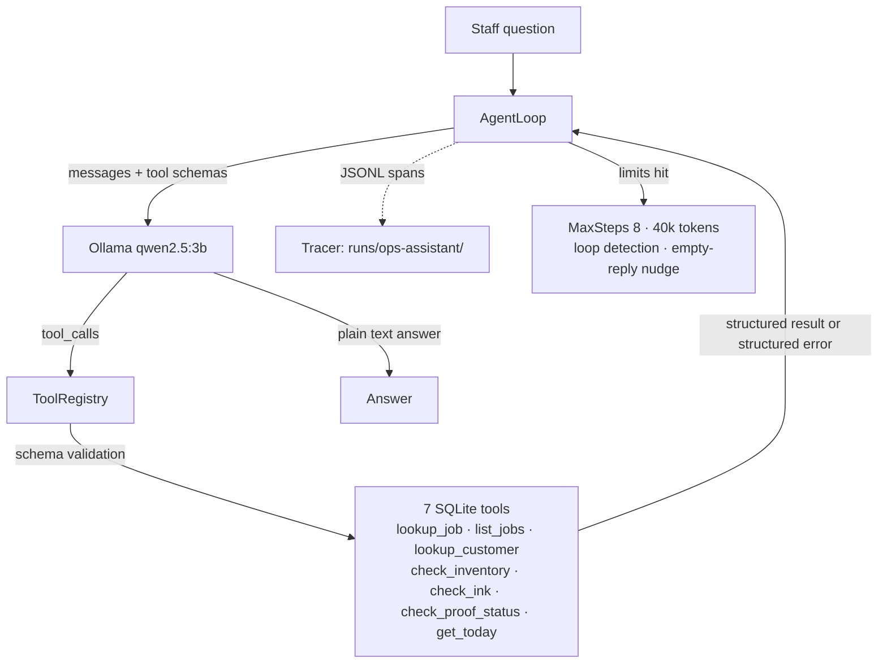

# P1 — Ops Assistant · Pattern 1: Tool Use (ReAct)

A staff-facing operations assistant for **Inkline Print Co.** (fictional Queensland screen-printing shop).
You ask it about jobs, customers, stock, ink or artwork proofs; it decides which database tools to call,
reads the results, and answers in plain English.

This is the **tool use / ReAct** pattern: *reason → act (tool call) → observe → repeat until it can answer*.

## Run it

```bash
dotnet run --project src/Patterns.OpsAssistant              # interactive chat
dotnet run --project src/Patterns.OpsAssistant -- --trace    # chat + trace tree after each answer
dotnet run --project src/Patterns.OpsAssistant -- --demo     # three scripted questions with trace trees
dotnet run --project src/Patterns.OpsAssistant -- --eval     # 20-case eval suite → evals/results/
```

Requires local Ollama with `qwen2.5:3b` (the loop, tracing and tools are SDK-free raw HTTP).

## Architecture



Key property: **every fact comes from a tool call**. The system prompt forbids outside knowledge,
and the loop guarantees tool results (or structured errors) are what the model reasons over.

## The seven tools

One job each, JSON-Schema validated before execution, failures returned as structured data the model can
read and recover from (never thrown):

| Tool | Job | Fails with a hint when… |
|---|---|---|
| `lookup_job` | one job by number | job number doesn't exist → suggests `list_jobs` |
| `list_jobs` | jobs by status/customer | no rows → lists valid statuses |
| `lookup_customer` | id or name fragment | no match → suggests shorter fragment / C01–C08 |
| `check_inventory` | blank stock + low flag | bad filter → lists garment types and sizes |
| `check_ink` | ink ml + low flag (<500 ml) | unknown colour → lists colours on hand |
| `check_proof_status` | proof versions for a job | no proofs → explains why |
| `get_today` | business date (frozen snapshot) | — |

## Eval results (real, live run)

`evals/ops-assistant.cases.jsonl` — 20 labelled questions × two scores:

- **tool match** — every expected tool was called (or any listed legitimate alternative path)
- **answer match** — required keywords present in the final answer (normalised: case, spaces,
  underscores, commas ignored) plus ≥1 optional phrase where the case offers phrasings

Latest run against `qwen2.5:3b`, temperature 0.2, max 8 steps / 40k tokens:

| Metric | Result |
|---|---|
| Tool match | **19/20 (95%)** |
| Answer match | **18/20 (90%)** |
| Full pass (both) | **18/20 (90%)** |
| Avg steps / question | 2.2 |
| Avg tokens / question | ~2,200 |
| Total tokens (all 20) | ~44,000 |

Full case-by-case table: [`evals/results/ops-assistant-results.md`](../../evals/results/ops-assistant-results.md).
Raw per-run records land in `runs/` (gitignored).

**The two honest failures:**

- **E17** — asked which jobs *Westlake Crossfit* has open, the model listed job 1010 (which belongs to
  Ferny Grove Bakery). Correct tool (`list_jobs`), wrong reasoning over the rows. A 3B model limitation.
- **E19** — a rush-caps question; the model searched customers/jobs instead of checking cap stock.
  Wrong tool choice; the eval caught it, which is the point.

## What the evals changed in the design

Two failures in the first eval round forced real loop hardening (both now covered by unit tests):

1. **Empty-reply nudge** — the model sometimes returned an empty final message. The loop now detects a
   blank answer, sends one corrective user message (*"Your reply was empty…"*), and only settles for a
   fallback message if it stays blank. Never returns an empty answer.
2. **Loop detection with a recovery round** — the model once re-called the same two tools three times
   in a row (E15). Rejected repeats are now fed back as a structured hint so the model gets **one chance
   to recover**; after three rejections the run stops (`StopReason.LoopDetected`) instead of burning
   tokens. E15 went from *empty answer, fail* → *recovers on step 4, passes*.

That sequence — run eval → design breaks → harden loop → rerun — is the whole point of shipping evals.

## Trace example

`--trace` / `--demo` print an OpenTelemetry-style tree; every span also lands as JSONL in `runs/`:

```text
trace run 20261019-113836-3419a3
[agent] agent: Could we fulfil a 60-shirt order… (1021ms)  stopReason=Completed steps=2 tokens=1951
  [llm]   llm call (step 1) (497ms)  promptTokens=910 completionTokens=29 toolCalls=1
  [tool]  tool: check_inventory (13ms)  args={"garment_type":"Tee","size":"M"} ok=True
  [llm]   llm call (step 2) (503ms)  promptTokens=984 completionTokens=28 toolCalls=0
total: 4 spans, llm tokens 1894 prompt + 57 completion
```

## How to talk about this in an interview

- **"How does an agent loop work?"** — messages in, model chooses tool or final answer, tool results append
  to the conversation, repeat. The naive loop is ~50 lines; the interesting engineering is the limits:
  step cap, token budget, loop detection, and never letting a tool exception escape as an exception.
- **"What breaks with small models?"** — point at the two eval-forced hardenings above and the two honest
  failures. Real answer: tool *selection* is mostly fine at 3B; long-horizon *reasoning* over tool results
  isn't. The eval suite tells you exactly where the cliff is instead of vibes.
- **"How do you evaluate an LLM feature?"** — deterministic scoring (tool-choice + normalised keyword
  anchors), 20 labelled cases in version control, live numbers in the results file, rerun after every change.
- **"Why no agent framework?"** — one visible loop you can debug byte-by-byte beats a framework you can't;
  the patterns here (ReAct, planning, reflection…) are what frameworks abstract, and this repo teaches them.

## What I'd do differently

- **Stronger model for production** — `qwen2.5:7b` fixes most of E17/E19-class reasoning errors; the
  README of the repo documents the upgrade path (same wire protocol, one env var: `AGENT_MODEL`).
- **Tool-result ranking** — `list_jobs` returns everything; a shop with 500 jobs would need pagination
  or retrieval (pattern in P5's repo search) before the model could see the rows.
- **Typed tool results** — results serialise from C# records as PascalCase; a shared camelCase contract
  and per-tool result DTOs would make prompts and tests tighter.
