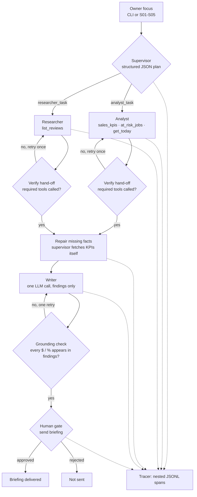

# P5 - Owner Briefing Pack - Pattern 5: Multi-Agent (Supervisor / Worker)

A screen-printing owner wants their Sunday-night briefing: *how did last week go, what's at risk,
what are customers saying, and what should I do this week?* A **supervisor** decomposes the job
into three focused tasks, an **analyst** and a **researcher** work in parallel over disjoint tool
belts, a **writer** turns their findings into one email, and a **human gate** holds the send.

This is the **supervisor / worker** pattern: *decompose → fan out → verify the hand-offs →
synthesise → gate*. The point isn't "more agents = better"; it's **bounded context per worker**
(the analyst never reads 12 review comments, the researcher never touches revenue), **attribution**
(every sentence in the trace is traceable to a worker and a tool), and a supervisor that does the
unglamorous part: **checks that workers actually did their job, repairs missing data, and refuses
to pass ungrounded figures to the writer**.

The eval is deliberately honest: on a 3B local model the multi-agent arm **does not beat a
well-guarded single agent on completeness** - it costs ~1.9× the tokens for the same score. What it
reliably buys is structure, traceability, and a place to put per-worker quality control. That
trade-off is measured and documented below, not hand-waved.

## Run it

```bash
dotnet run --project src/Patterns.OwnerBriefing                       # demo: supervisor → workers → briefing → gate
dotnet run --project src/Patterns.OwnerBriefing -- --auto             # non-interactive (gate auto-approved)
dotnet run --project src/Patterns.OwnerBriefing -- --focus "cash is tight this month"  # custom owner focus
dotnet run --project src/Patterns.OwnerBriefing -- --single           # control arm: one agent, all tools
dotnet run --project src/Patterns.OwnerBriefing -- --show-workers     # print analyst/researcher findings
dotnet run --project src/Patterns.OwnerBriefing -- --facts            # code-computed ground truth
dotnet run --project src/Patterns.OwnerBriefing -- --eval             # 5 focuses × 2 architectures
```

Requires local Ollama with `qwen2.5:3b`. Traces and briefing texts save to `runs/owner-briefing/`.
Exit code is `0` only when the human gate approves the send.

## Architecture



| Stage | What happens | Failure handling |
|---|---|---|
| **decompose** | Supervisor returns `{analyst_task, researcher_task, writer_task}` via structured output; a guardrail tells it the analyst must always cover last week, WoW, 4-week averages and all at-risk jobs regardless of focus | Invalid/empty JSON → retry with validation error |
| **fan out** | Analyst and researcher run concurrently (`Task.WhenAll`) over **disjoint belts**; each has its own agent loop, step cap and trace span | Tool errors are structured and loop detection applies (core `AgentLoop`) |
| **verify** | After each worker, the supervisor checks the **tool-call record**: analyst must have called `sales_kpis` with `window_weeks ≥ 4` and `at_risk_jobs`; researcher must have called `list_reviews` | Retry the worker once with the violation text in the task; tags `supervisorRejected` / `supervisorRetry` |
| **repair** | If the analyst's findings are missing a core KPI (revenue, WoW, 4-week average, any at-risk job), the supervisor **calls the tools itself** and prepends authoritative facts for the writer | Deterministic, no extra LLM calls; traced as `supervisor: repair missing facts` |
| **synthesise** | Writer gets the three task briefs + worker findings (no tools) and writes the email | `$`/`%` figures must appear in findings; one retry, tag `ungroundedFigures` |
| **gate** | `HumanGate` approves/edits/rejects the send; `--auto` auto-approves | Exit code reflects `gate.ShouldProceed` |

## What the evals changed in the design

Five owner focuses (standard, cash, quality, risk, growth) each run through **both** architectures
with the same tools, data and required output shape. The rubric is 7 deterministic checks against
**code-computed ground truth** - no LLM judge.

1. **Sibling spans corrupted the trace file.** Fan-out with `Task.WhenAll` completed two sibling
   spans at the same instant; both appended to the JSONL trace and one write failed with a sharing
   violation. Fixed in core: the sink **appends inside the tracer lock**, with two new concurrency
   tests. Lesson: tracing is concurrent code the moment you parallelise agents.
2. **The plan came back empty.** The supervisor's JSON used `analystTask`; `System.Text.Json` was
   configured for snake_case. Fix: explicit `[JsonPropertyName]` on the plan record - the same trap
   I'd hit once already in P4's eval cases, so it's now on the pre-flight checklist for any
   structured-output DTO.
3. **`/api/generate` ran for ten minutes.** One writer generation ignored the format rules and kept
   emitting until the HTTP client timed out (eval S04). Fix: `num_predict = 1024` in the request
   options - a hard output budget at the client, not just a prompt request.
4. **The analyst skipped its tools.** Under a narrow focus it answered from the prompt ("cash is
   tight") instead of fetching data, leaving the writer to invent numbers. Prompt wording was not
   enough. Fix: **verify the tool-call record** after each worker, retry once with the specific
   violation, and if a core KPI is still missing, the **supervisor fetches it and injects it**.
   This is the pattern's real supervisory work.
5. **The writer rounded away the truth** ("40% decrease" for −40.7%). Fix: a grounding check that
   every `$`/`%` figure in the briefing appears in worker findings, with one retry. Residual: the
   check catches *new* figures, not *distorted* ones - S02 still fails `wow_direction` this way.

## Eval results (real, live run)

`data/sales.csv` - 11 weeks (2026-08-03 → 2026-10-12); `data/reviews.csv` - 12 reviews (R001-R012).
World date is fixed at **2026-10-18**, so "last week", "due within 7 days" and "overdue" are
deterministic. Cases: `evals/owner-briefing.cases.jsonl` (S01-S05).

Latest committed run (`qwen2.5:3b`, `qwen2.5:3b` for both arms):

| Focus | Multi-agent | Single-agent |
|---|---|---|
| S01 standard | **7/7** | 2/7 (fail) |
| S02 cash | **7/7** | 7/7 |
| S03 quality | 5/7 (fail) | **7/7** |
| S04 risk | **7/7** | 7/7 |
| S05 growth | 6/7 | **7/7** |
| **Total** | **32/35 · 4/5 pass** | **30/35 · 4/5 pass** |

| Architecture | Avg tokens | Total tokens | Avg time | Total time | Avg LLM calls |
|---|---|---|---|---|---|
| Multi-agent | 7,840 | **39,200** | 18,289 ms | 91,444 ms | 6.8 |
| Single-agent | 4,164 | **20,818** | 13,692 ms | 68,460 ms | 2.0 |

Check breakdown (multi / single): last-week revenue 5/5 / 5/5 · WoW 4/5 / 4/5 · 4-week turnaround
3/5 / 4/5 · at-risk job **5/5 / 4/5** · low-rating theme **5/5 / 4/5** · action items
**5/5 / 4/5** · focus coverage 5/5 / 5/5.

Full table, ground truth and misses:
[`evals/results/owner-briefing-results.md`](../../evals/results/owner-briefing-results.md).

**The honest finding:** over **four back-to-back evals** the two arms traded the lead
(multi 34, 33, 32, 32 /35; single 30, 34, 32, 30 /35; pass rates 5/5, 5/5, 4/5, 4/5 vs 4/5, 5/5,
5/5, 4/5). At 3B, **completeness is run-to-run noise** - I am not going to claim a quality win the
data doesn't support. In the committed run the multi arm's misses were numeric completeness
(S03/S05 omitted the 4-week turnaround); the single arm's S01 answer missed five checks at once
(WoW, turnaround, at-risk jobs, low-rating theme and action items) and S05 missed the at-risk jobs.
Neither
architecture is reliably complete.

The differences that held up:

- **Structure:** in the committed run multi was 5/5 on at-risk-job, low-rating-theme and action
  items; single was 4/5 on each. Small, but consistent with the supervisor's repair step and its
  narrower worker contexts.
- **Cost:** ~1.9× tokens and ~1.3× wall-clock (Ollama serialises the fan-out on one GPU, so
  "parallel" here means interleaved, not faster).
- **Attribution:** only the multi trace tells you *which worker* and *which tool call* produced a
  sentence - visible in the trace excerpt below.

## Trace example

`--auto` (standard focus) - note the nested workers, the verified hand-offs, and the expensive-span
report. The analyst's `at_risk_jobs` result says *due in* 1/3/6 days; the briefing says the same
(no "overdue" mislabel - one of the prompt fixes above):

```text
SUPERVISOR PLAN
  analyst   : Review last week's revenue and orders, compare with previous weeks, identify any at-risk projects, and summarize job statuses.
  researcher: Analyze low-rated customer reviews, summarize key themes, and identify recurring issues.
  writer    : Craft the briefing to highlight revenue trends, at-risk projects, and customer feedback, emphasizing actionable insights.
[gate] AUTO-APPROVED: Send the Sunday-night owner briefing to the owner's inbox

trace run 20261023-132822-1b1f7e
[agent] briefing run (multi-agent) (17679ms)  tokens=6351 llmCalls=6 gate=Approved
  [span]  supervisor: decompose (1737ms)  analystTask=Review last week's revenue and orders, ... researcherTask=Analyze low-rated ...
    [llm]   llm call (1721ms)  jsonMode=True tools=0 promptTokens=270 completionTokens=83
  [agent] worker: analyst (5561ms)  steps=2 toolCalls=2 stop=Completed promptTokens=2388 completionTokens=302
    [agent] agent: Review last week's revenue and orders, compare with previ... (5554ms)  maxSteps=5 stopReason=Completed
      [llm]   llm call (step 1) (689ms)  toolCalls=2
      [tool]  tool: sales_kpis (19ms)  args={"window_weeks":4} ok=True
      [tool]  tool: at_risk_jobs (24ms)  args={} ok=True
      [llm]   llm call (step 2) (4817ms)  toolCalls=0
  [agent] worker: researcher (8636ms)  steps=2 toolCalls=1 stop=Completed
    [agent] agent: Analyze low-rated customer reviews, summarize key themes,... (8636ms)  maxSteps=5 stopReason=Completed
      [llm]   llm call (step 1) (998ms)  toolCalls=1
      [tool]  tool: list_reviews (8ms)  args={} ok=True
      [llm]   llm call (step 2) (7627ms)  toolCalls=0
  [span]  worker: writer (7274ms)  chars=1571 ungroundedFigures=0 promptTokens=864 completionTokens=446
    [llm]   llm call (7273ms)  jsonMode=False tools=0 toolCalls=0
  [gate]  gate: send briefing (0ms)  decision=Approved
total: 17 spans, llm tokens 5334 prompt + 1017 completion

MOST EXPENSIVE SPANS
   17679 ms  Agent   briefing run (multi-agent)
    8636 ms  Agent   agent: Analyze low-rated customer reviews, summarize key themes,...
    8636 ms  Agent   worker: researcher
```

The briefing itself carries `$6,690.25`, `-40.7%`, `$7,283.94`, `9.25 days`, jobs **1002 / 1011 /
1010**, the three low-rating themes and three actions - all traceable to a tool result.

## How to talk about this in an interview

- **"When does multi-agent actually pay?"** - when the subtasks need **different context and
  different permissions**, and when you need **attribution** for debugging or audit. Here the
  researcher reads a review corpus the analyst shouldn't need, the analyst owns money/deadline
  tools, and every finding keeps its worker label into the trace. For a small, single-context job
  like this one, a guarded single agent is cheaper and just as accurate - I measured that.
- **"How do you stop a supervisor from being a router with extra steps?"** - the supervisor does
  three jobs a router doesn't: it **plans** (structured, per-focus tasks), **verifies hand-offs**
  (tool-call record + required window), and **repairs** (fetches missing facts itself). The retry
  and repair paths are the pattern; without them the fan-out is just more prompts.
- **"How do you keep numbers honest across a fan-out?"** - numbers live in tools, not workers; the
  writer gets findings, not tools; a grounding check rejects any `$`/`%` not present in findings
  (one retry); the supervisor injects authoritative facts when a worker's findings are incomplete;
  and the eval scores every KPI against code-computed ground truth.
- **"What did parallelism buy you?"** - on one local GPU, **nothing in latency** (~1.3× slower,
  since requests contend for the same model). It buys **isolation of context** and a cleaner trace,
  not speed. On separate models/GPUs the same fan-out is where the wall-clock win would appear.
- **"What's the failure mode you'd watch in production?"** - a worker that reports success without
  doing the work. The 3B analyst did exactly that under a narrow focus, so QA is on the **tool-call
  record and the output**, not the worker's self-report. The supervisor also caps steps and output
  tokens so a runaway generation can't hang the run.

## What I'd do differently

- **Give the single arm the same output verifier** for a clean comparison. Right now multi gets
  writer grounding and supervisor repair; single gets neither. Equal QA would isolate the
  architecture variable instead of conflating it with guardrails (and I expect both arms to reach
  5/5, making cost the only difference).
- **Budget the plan, not just the tasks.** The supervisor should decide *whether* the researcher is
  needed for a cash-only focus, and skip the call entirely. A supervisor's most valuable output is
  sometimes "don't spawn that worker".
- **Share a tool-result cache across workers.** `get_today` and window boundaries are fetched by
  both belts; a per-run memo would cut a call and guarantee the same world date everywhere.
- **Contract-test each worker prompt.** The analyst's "call `sales_kpis` once with
  `window_weeks=4`" rule is prompt-enforced then code-verified; a tiny worker-level eval suite
  would catch regressions before the 5-scenario end-to-end run.
- **Map-reduce for a real review corpus.** 12 reviews fit one context; 1,200 need chunked
  summarisation with per-chunk themes and a reducer. The current researcher prompt is the
  degenerate case, and I'd want the eval to grow with the data.
- **Move the gate decision into the report.** The briefing is approved as a blob; a production gate
  would show per-claim provenance (worker + tool call) in the UI, which is exactly what the trace
  already contains.
