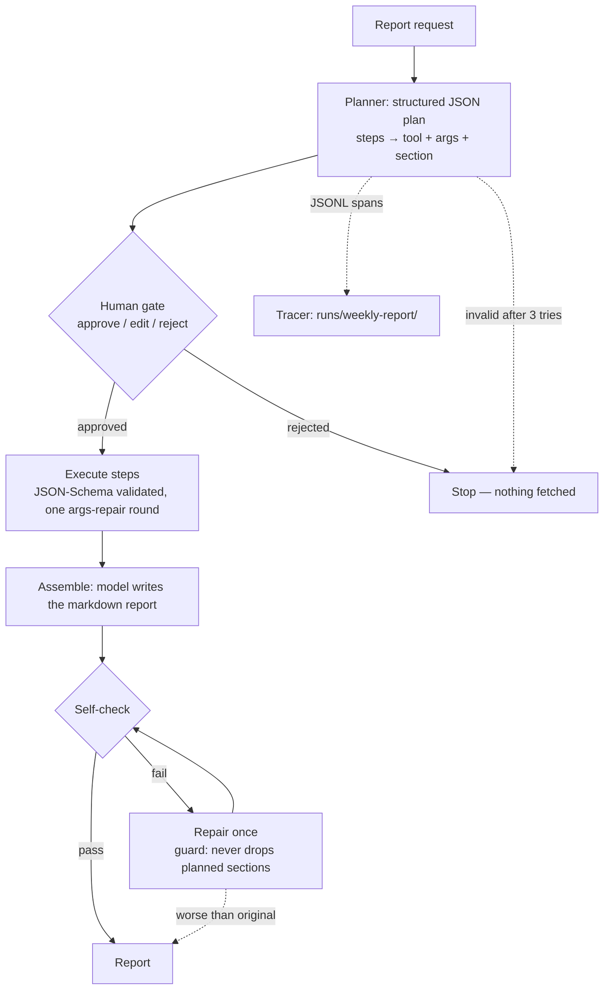

# P2 — Weekly Report · Pattern 2: Planning & Task Decomposition

The owner of **Inkline Print Co.** (fictional Queensland screen-printing shop) asks for a weekly report in
plain English — *"what needs chasing, what's owed, what's low, what are people saying?"* — and this agent
turns that into a **written plan of tool steps a human approves before anything runs**, executes the steps,
writes the report, and checks its own work.

This is the **planning / task decomposition** pattern: *decompose the goal → plan steps as tool calls →
gate on a human → execute → assemble → self-verify*.

## Run it

```bash
dotnet run --project src/Patterns.WeeklyReport                    # default report, interactive gate
dotnet run --project src/Patterns.WeeklyReport -- "Your request"  # custom request (arg), gate still interactive
dotnet run --project src/Patterns.WeeklyReport -- --auto          # non-interactive (gate auto-approved)
dotnet run --project src/Patterns.WeeklyReport -- --eval          # 10 full-pipeline cases → evals/results/
```

Requires local Ollama with `qwen2.5:3b`. Reports save to `runs/weekly-report/`; every phase is traced.

## Architecture



Five phases, each a traced span:

| Phase | What happens | Failure handling |
|---|---|---|
| **plan** | Model returns validated JSON: steps with tool + args + report section | 3 attempts, error fed back; invalid plan → stop, nothing runs |
| **gate** | The plan is shown to a human **before any tool runs** | Approve / edit (re-parsed as JSON) / reject |
| **execute** | Each step runs one tool; results are structured data | Bad args → one model-driven repair round, then fail that step |
| **assemble** | Model writes the markdown report from the gathered data | Code fences stripped; every planned section must appear |
| **verify** | Self-check against the plan | Issues → one repair round, guarded (see below) |

## What the evals changed in the design

Four separate rounds of *run eval → design breaks → harden → rerun*:

1. **JSON binding bug** — the model faithfully copies `verification_criteria` (snake_case) from the prompt
   example, but System.Text.Json doesn't bind multiword snake_case keys by default — so every plan looked
   "missing the field" and retries degraded into garbage. Fixed with explicit `[JsonPropertyName]` binding
   (and a synthesised default when the model omits it entirely).
2. **Placeholder copying** — the prompt example used `"..."` as values; the model copied literal `...` into
   the goal. The example now uses realistic values to pattern-match instead.
3. **A verifier that cried wolf** — the LLM self-check matched section names *literally* (`ink_levels`
   ≠ `## Ink Levels`), failed **0/10**, and triggered a "repair" round that *corrupted* good reports
   (echoing review notes into the report body, dropping sections). The self-check is now **hybrid**:
   section presence is a deterministic code check (word-overlap against headings); the LLM only judges
   what needs judgement — factual issues — and its `ok` flag is ignored in favour of computed results.
4. **Repair guard** — even with a better verifier, a small model's repair can lose sections. The pipeline
   now compares section coverage before/after and **keeps the original if the repair dropped content**.

## Eval results (real, live run)

`evals/weekly-report.cases.jsonl` — 10 report requests, each running the **full pipeline** (plan →
auto-approved gate → execute → assemble → verify), scored on three axes:

- **plan ok** — pipeline completed, every planned step executed
- **tool match** — every expected tool ran
- **report match** — required keyword anchors in the final report (normalised for case/spaces/underscores)

Latest committed run against `qwen2.5:3b`, temperature 0.2:

| Metric | Result |
|---|---|
| Plan ok | **9/10 (90%)** |
| Step success | 38/39 (97%) |
| Tool match | **9/10 (90%)** |
| Report keyword match | **6/10 (60%)** |
| Full pass (all three) | **6/10 (60%)** |
| Agent self-check passed | 6/10 (60%) |
| Avg LLM calls / tokens per case | 3.9 / ~4,800 |

Across three eval runs during hardening, full pass ranged **6–7/10** — run-to-run variance from a 3B model
is real and is itself worth knowing. Full case-by-case table:
[`evals/results/weekly-report-results.md`](../../evals/results/weekly-report-results.md).

**The honest failures (all model, not pipeline):**

- **E01** — the planner *wanted* every unpaid-cent (`status:"unpaid,overdue,disputed"` — smart intent!)
  but the tool takes one enum value; the args-repair round couldn't fix it at 3B.
- **E07 / E10** — over-filtering: `status:"unpaid"` when the question asked for overdue too, and
  `weeks:1` (last week only) when asked for the best week of the year. The prompt says *omit filters
  unless asked*; the model still reaches for them under uncertainty.
- **E03** — the tools returned the right rows (Tee M, 15, low); the assemble step wrote about the
  wrong ones. Reasoning-over-data limits, same cliff P1 documented.

Planning is harder than answering: P1 scores 90% on single questions, this scores 60% on full pipelines —
the eval suite says exactly where the 3B cliff is.

## Trace example

`--auto` prints the plan for approval, then the execution and report; the trace tree shows every phase:

```text
PLAN (6 steps):
  1. [jobs_at_risk] Get the business date for the report.
     → get_today
  2. [jobs_at_risk] List all print jobs ordered by due date.
     → list_jobs {"status":"quoted"}
  ...
[gate] AUTO-APPROVED: fetch data and produce the weekly report with this plan
  step 1 [get_today] done (6 ms)
  ...
[assemble] 1390 chars

trace run 20261020-133810-1ddd81
[agent] weekly report: Produce the weekly operations report… (16338ms)  outcome=Completed planSteps=6 failedSteps=0 llmCalls=3 tokens=4189 verifiedOk=True
  [span]  phase: plan (7798ms)  steps=6 ok=True
  [gate]  phase: gate (2ms)  decision=Approved
  [span]  phase: execute 6 steps (158ms)  steps=6 failed=0 repaired=0
  [span]  phase: assemble (7951ms)  chars=1390
  [span]  phase: verify (408ms)  ok=True issues=0
total: 15 spans, llm tokens 3278 prompt + 911 completion
```

Note the plan above: the model chose `list_jobs {status:"quoted"}` for the at-risk section — a planning
mistake the human gate exists to catch. Interactive mode shows this plan **before** any data is fetched;
the operator can edit it (rejected edits abort safely).

## How to talk about this in an interview

- **"How does an agent plan?"** — the model decomposes the request into ordered tool steps as validated
  JSON *before* acting; a human approves the plan, not each tool call. Planning moves the reviewable
  artifact from 15 scattered actions to one page.
- **"What breaks when the plan is wrong?"** — point at E01/E07/E10. Validation catches *structural* errors
  (unknown tools, bad enums via the repair round); *semantic* over-filtering needs either a stronger model
  or the human gate. The eval suite tells you which failures are which.
- **"How do you self-check an agent's work?"** — don't trust the LLM with what code does better. Hybrid:
  deterministic section-coverage in code, LLM only for factual judgement, and a repair round that can
  never make the report structurally worse. The 0/10-verifier history is the argument.
- **"Where do you put the human?"** — after planning, before execution. Cheapest moment to stop a bad
  run: nothing has been fetched, and the whole plan fits on one screen.

## What I'd do differently

- **7B for planning** — tool *args* quality (E01/E07/E10) is the cliff; `qwen2.5:7b` mostly fixes it, and
  the wire protocol is identical (one env var).
- **Enum-aware args validation at plan time** — the schema already knows `status` is an enum; validating
  plan-time args against it (before the gate) would catch E01's failure a phase earlier.
- **Streaming the plan** — interactive mode could show steps as the model emits them; today the gate
  sees the plan only once JSON mode finishes.
